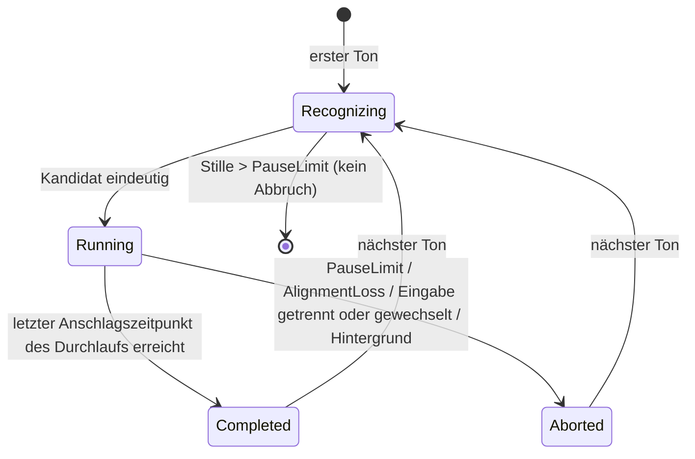

# Datenmodell: Legato MVP

**Plan**: [plan.md](plan.md) | **Spec**: [spec.md](spec.md) | **Glossar**: [glossar.md](../../docs/glossar.md#bezeichner-im-code)

Bezeichner sind englisch und folgen dem [Glossar](../../docs/glossar.md#bezeichner-im-code); Beschreibungen sind deutsch. Alle Entitäten liegen im Kern (`core/`), sofern nicht anders angegeben. Zeiten sind Mikrosekunden (`u64`) seit Beginn der Übeeinheit, gemessen am Zeitstempel des MIDI-Treibers.

## Noten

### `Work` (Werk)
| Feld | Typ | Regel |
|---|---|---|
| `id` | String | z. B. `hanon` |
| `composer`, `title` | String | aus MusicXML-Metadaten |
| `rules` | `WorkRules` | Modul je Werkspezifikation, sonst allgemeine Regeln ([research.md R10](research.md#r10--werkregeln-fr-009)) |

### `Piece` (Stück)
| Feld | Typ | Regel |
|---|---|---|
| `id` | String | Hash des Dateiinhalts (stabil über Neustarts) |
| `work` | → `Work` | |
| `number` | String? | z. B. `1` |
| `source` | `Bundled` \| `File` | `Bundled` nur Hanon Nr. 1 (FR-010) |
| `score` | `Score` | |
| `has_fingering` | bool | `true`, wenn jede Note einen Fingersatz hat; sonst sind fingersatzabhängige Analysen gekennzeichnet (US 2, Szenario 3) |

### `Score` (Notentext)
| Feld | Typ | Regel |
|---|---|---|
| `onsets` | Liste von `Onset` | zeitlich geordnet |
| `sections` | Liste von `Section` | aus Wiederholungszeichen |
| `rests_before` | Menge von Onset-Indizes | Anschlagszeitpunkte, vor denen eine notierte Pause liegt (FR-020) |
| `measures` | Liste von `Measure` | für Anzeige und Noten-IDs; je Takt die Nummer und ob er mit einem Doppelstrich endet |

### `Onset` (Anschlagszeitpunkt)
Alle gleichzeitig zu spielenden Noten.

| Feld | Typ | Regel |
|---|---|---|
| `index` | u32 | |
| `notes` | Liste von `Note` | mindestens eine |
| `successors` | Liste von Onset-Indizes | normal `index + 1`; am Ende eines Wiederholungsabschnitts zusätzlich dessen Anfang (FR-014) |

### `Note`
| Feld | Typ | Regel |
|---|---|---|
| `id` | `NoteId` | `(measure, voice, index)`; stabil, nur intern; die Oberfläche adressiert Noten über die Anzeige-ID ([contracts/engine-schnittstelle.md](contracts/engine-schnittstelle.md#nachrichten-an-score-view-web)) |
| `pitch` | u8 | MIDI-Notennummer, in C-Dur wie notiert |
| `hand` | `Left` \| `Right` | aus der Stimme (5–8 = links), ohne Stimmen 5–8 aus dem Notensystem (unteres = links); siehe [contracts/notendatei.md](contracts/notendatei.md) |
| `finger` | u8? | 1–5 |

### `Section` (Abschnitt)
| Feld | Typ | Regel |
|---|---|---|
| `kind` | `Repeat` \| `Ending` | |
| `start`, `end` | Onset-Index | |
| `parts` | Liste benannter Bereiche | Hanon: `Ascending`, `Descending` (Aufwärts, Abwärts; getrennt am Doppelstrich, ohne Doppelstrich erste/zweite Hälfte der Takte) |

### `Candidate` (Kandidat)
Eine zulässige Kombination für die Erkennung.

| Feld | Typ | Regel |
|---|---|---|
| `piece` | → `Piece` | |
| `variation` | `BothHands` \| `LeftHandOnly` \| `RightHandOnly` | |
| `transposition` | i8 | Halbtöne; Hanon 0–11 (FR-015) |

`WorkRules` liefert die zulässigen Kandidaten; der `RecognitionFilter` (FR-018) filtert sie. Die Vorauswahl (`RecognitionMethod`, [research.md R15](research.md#r15--vorauswahl-bei-der-erkennung-fr-085)) bestimmt, welche davon während der Erkennung verfolgt werden.

## Üben

### `PracticeSession` (Übeeinheit)
| Feld | Typ | Regel |
|---|---|---|
| `started_at` | Zeit | erster Ton nach Start bzw. nach Rückkehr in den Vordergrund |
| `performances` | Liste von `Performance` | nur abgeschlossene |

Die Übeeinheit endet nach `session_idle_timeout_ms` ohne Ton, beim Beenden der App oder im Hintergrund (Glossar „Übeeinheit“). Solange sie läuft, ist die Bildschirmsperre unterdrückt (NFR-005).

### `Performance` (Durchlauf)
| Feld | Typ | Regel |
|---|---|---|
| `candidate` | `Candidate` | steht ab Beginn fest (FR-016) |
| `input` | `Midi` | Audio folgt in [006](../006-audio-eingabe/spec.md) |
| `played_notes` | Liste von `PlayedNote` | inkl. der Töne vor eindeutiger Erkennung |
| `alignment` | Liste von (`PlayedNote` → `NoteId` \| `Deviation`) | während des Spiels |
| `deviations` | Liste von `Deviation` | |
| `state` | `PerformanceState` | siehe Zustandsübergänge |

**Zustandsübergänge** (`PerformanceState`):

Abgebrochene Durchläufe werden verworfen. Nach `Completed` läuft der bisherige Kandidat als einer unter allen zugelassenen weiter, sodass nahtloses Wiederholen ebenso erkannt wird wie ein Wechsel (US 3, Szenario 2).

### `PlayedNote` (gespielter Ton)
| Feld | Typ | Regel |
|---|---|---|
| `pitch` | u8 | |
| `velocity` | u8 | |
| `onset`, `offset` | Zeit, Zeit? | `offset` nach Note-Off |

### `Deviation` (Abweichung)
| Feld | Typ | Regel |
|---|---|---|
| `kind` | `Omission` \| `Substitution` \| `Addition` | Ungleichmäßigkeiten (`Unevenness`) folgen in 002 |
| `note` | `NoteId`? | nicht bei `Addition` |
| `played` | `PlayedNote`? | nicht bei `Omission` |
| `hand`, `finger` | aus der Note bzw. dem nächstgelegenen Anschlagszeitpunkt | Constitution VI |

## Eingabe und Signale (Engine)

### `InputState` (Eingabezustand)
`Disconnected` → `MidiConnected` ↔ `ConnectionLost`. Bei `ConnectionLost` gibt es zusätzlich `warning_acknowledged`. Der Wechsel `MidiConnected` → `ConnectionLost` startet die `DisconnectWarning` (FR-005), `ConnectionLost` → `MidiConnected` sendet das `ConnectSignal` (FR-027). Der Zustand `AudioConnected` (US 1 Szenario 5) folgt mit der Audio-Eingabe in [006](../006-audio-eingabe/spec.md).

### `SignalPlanner` (Signalplan)
Die Ereignisse `PerformanceCompleted`, `PerformanceAborted`, `Stopped` und `Connected` werden gemäß Einstellungen in MIDI-Tonfolgen (`ConnectSignal`, `OkSignal`, `AbortSignal`) übersetzt. Für „wenn der Pianist aufgehört hat“ merkt sich der Planer, ob seit dem letzten `OkSignal` ein Durchlauf abgeschlossen wurde (US 4, Szenarien 2 und 3).

## `Settings` (Einstellungen, persistiert)

| Bereich | Feld | Standard |
|---|---|---|
| Eingabe | `midi_device` (Name, Art USB/Bluetooth, Bluetooth-Kennung) | keins |
| Eingabe | `signal_device` | = `midi_device` (US 1, Szenario 14) |
| Erkennung | `recognition_filter` (Stücke, Variationen, Tonarten) | keiner |
| Erkennung | `recognition_method` (FR-085) | vorläufig `EditDistance`, endgültig nach S3 Teil 2; Alternativen `Exhaustive`, `Fingerprint` |
| Zuordnung | `pause_limit_ms` | 4000 |
| Zuordnung | `rest_limit_ms` | 10000 |
| Übeeinheit | `session_idle_timeout_ms` (Ruhezeit) | 600000 |
| Zuordnung | `score_follower` | nach Spike S3 (`Pthmm` oder `OuterHmm`); Alternative `Arzt` |
| Anzeige | `display_variant` je Werk | `Full` |
| Anzeige | `score_zoom_percent` (50–200 in 25er-Schritten) | 100 |
| Anzeige | `error_marking_during` je Abweichungsart | aus |
| Anzeige | `error_marking_after` je Abweichungsart | aus |
| Signale | `connect_signal` | `On` |
| Signale | `ok_signal` | `WhenStopped` (Alternativen `EveryPerformance`, `Off`) |
| Signale | `abort_signal` | `Immediately` (Alternative `Off`) |
| Signale | Tonfolgen, Lautstärke | höchstens 2 Töne, leise (Velocity 30), hohe Lage (C7/E7) |

Änderungen gelten ab dem nächsten Durchlauf (FR-032, US 3 Szenario 14, US 4 Szenario 7).
