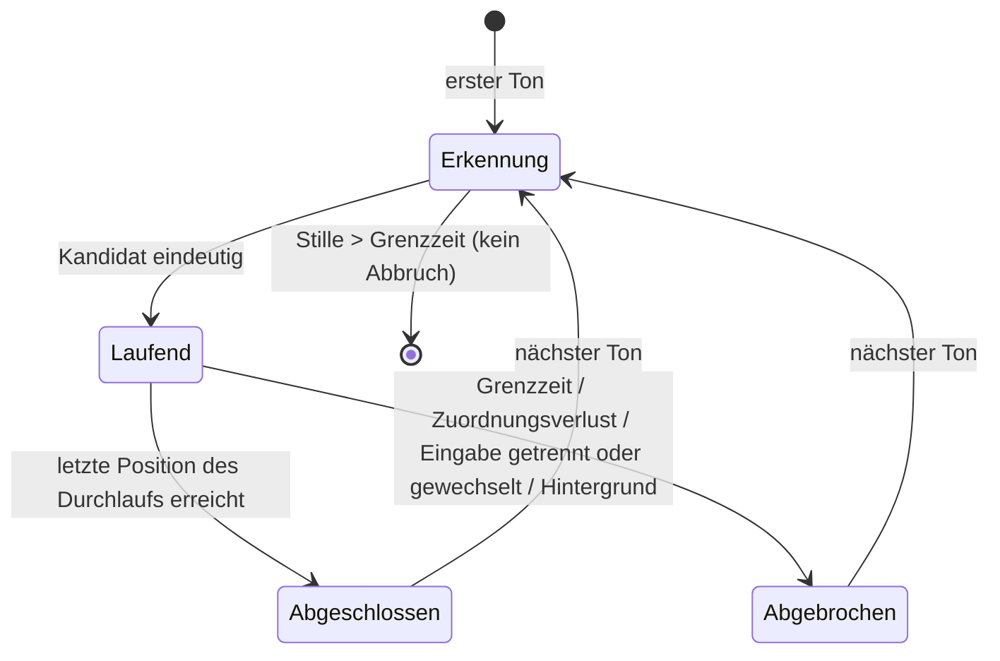

# Datenmodell: Legato MVP

**Plan**: [plan.md](plan.md) | **Spec**: [spec.md](spec.md) | **Glossar**: [glossar.md](../../docs/glossar.md)

Alle Entitäten liegen im Kern (`core/`), sofern nicht anders angegeben. Zeiten sind Mikrosekunden (`u64`) seit Start der Übeeinheit, gemessen am Zeitstempel des MIDI-Treibers.

## Noten

### Werk
| Feld | Typ | Regel |
|---|---|---|
| `id` | String | z. B. `hanon` |
| `komponist`, `titel` | String | aus MusicXML-Metadaten |
| `regel` | `Werkregel` | Modul je Werkspezifikation, sonst allgemeine Regel ([research.md R9](research.md#r9--werkregeln-fr-009)) |

### Stück
| Feld | Typ | Regel |
|---|---|---|
| `id` | String | Hash des Dateiinhalts (stabil über Neustarts) |
| `werk` | → Werk | |
| `nummer` | String? | z. B. `1` |
| `quelle` | `Mitgeliefert` \| `Datei` | Mitgeliefert nur Hanon Nr. 1 (FR-010) |
| `notentext` | Notentext | |
| `hat_fingersatz` | bool | `true`, wenn jede Note einen Fingersatz hat; sonst sind fingersatzabhängige Analysen gekennzeichnet (US 2, Szenario 3) |

### Notentext
| Feld | Typ | Regel |
|---|---|---|
| `positionen` | Liste von Position | zeitlich geordnet |
| `abschnitte` | Liste von Abschnitt | aus Wiederholungszeichen |
| `pausen` | Menge von Positions-Indizes | Positionen, vor denen eine notierte Pause liegt (FR-020) |
| `takte` | Liste von Takt | für Anzeige und Noten-IDs |

### Position
Ein Anschlagszeitpunkt im Notentext (alle gleichzeitig zu spielenden Noten).

| Feld | Typ | Regel |
|---|---|---|
| `index` | u32 | |
| `noten` | Liste von Note | mindestens eine |
| `nachfolger` | Liste von Positions-Index | normal `index + 1`; am Ende eines Wiederholungsabschnitts zusätzlich dessen Anfang (FR-014) |

### Note
| Feld | Typ | Regel |
|---|---|---|
| `id` | NotenId | `(takt, stimme, index)`; stabil, wird in erzeugtes MusicXML geschrieben |
| `tonhoehe` | u8 | MIDI-Notennummer, in C-Dur wie notiert |
| `hand` | `Links` \| `Rechts` | aus Notensystem (unteres = links) |
| `finger` | u8? | 1–5 |

### Abschnitt
| Feld | Typ | Regel |
|---|---|---|
| `art` | `Wiederholung` \| `Ende` | |
| `von`, `bis` | Positions-Index | |
| `teile` | Liste benannter Bereiche | Hanon: `Aufwärts`, `Abwärts` (erste/zweite Hälfte der Takte) |

### Kandidat
Eine zulässige Kombination für die Erkennung.

| Feld | Typ | Regel |
|---|---|---|
| `stueck` | → Stück | |
| `variation` | `Beidhändig` \| `NurLinks` \| `NurRechts` | |
| `transposition` | i8 | Halbtöne; Hanon 0–11 (FR-015) |

Die Werkregel liefert die zulässigen Kandidaten; die Einschränkung (FR-018) filtert sie.

## Üben

### Übeeinheit
| Feld | Typ | Regel |
|---|---|---|
| `beginn` | Zeit | erster Ton nach Start bzw. nach Rückkehr in den Vordergrund |
| `durchlaeufe` | Liste von Durchlauf | nur abgeschlossene |

### Durchlauf
| Feld | Typ | Regel |
|---|---|---|
| `kandidat` | Kandidat | steht ab Beginn fest (FR-016) |
| `eingabe` | `Midi` | Audio folgt in [006](../006-audio-eingabe/spec.md) |
| `toene` | Liste von Ton | inkl. der Töne vor eindeutiger Erkennung |
| `zuordnung` | Liste von (Ton → NotenId \| Abweichung) | während des Spiels |
| `abweichungen` | Liste von Abweichung | |
| `zustand` | siehe Zustandsübergänge | |

**Zustandsübergänge**:

Abgebrochene Durchläufe werden verworfen. Nach `Abgeschlossen` läuft der bisherige Kandidat als einer unter allen zugelassenen weiter, sodass nahtloses Wiederholen ebenso erkannt wird wie ein Wechsel (US 3, Szenario 2).

### Ton
| Feld | Typ | Regel |
|---|---|---|
| `tonhoehe` | u8 | |
| `anschlag` | u8 | Velocity |
| `beginn`, `ende` | Zeit, Zeit? | `ende` nach Note-Off |

### Abweichung
| Feld | Typ | Regel |
|---|---|---|
| `art` | `Auslassung` \| `FalscherTon` \| `Zusatzton` | Ungleichmäßigkeiten folgen in 002 |
| `note` | NotenId? | nicht bei Zusatzton |
| `ton` | Ton? | nicht bei Auslassung |
| `hand`, `finger` | aus der Note bzw. der nächstgelegenen Position | Constitution VI |

## Eingabe und Signale (Backend)

### Eingabezustand
`NichtVerbunden` → `MidiVerbunden` ↔ `Abgebrochen`. Bei `Abgebrochen` gibt es zusätzlich das Merkmal `warnung_bestaetigt`. Der Wechsel `MidiVerbunden` → `Abgebrochen` startet die Warnung (FR-005), `Abgebrochen` → `MidiVerbunden` sendet das Verbindungssignal (FR-027).

### Signalplan
Ereignisse `DurchlaufAbgeschlossen`, `DurchlaufAbgebrochen`, `Aufgehoert`, `Verbunden` werden gemäß Einstellungen in MIDI-Tonfolgen übersetzt. Für „wenn der Pianist aufgehört hat“ zählt ein Merker, ob seit dem letzten OK-Signal ein Durchlauf abgeschlossen wurde (US 4, Szenarien 2 und 3).

## Einstellungen (persistiert)

| Bereich | Feld | Standard |
|---|---|---|
| Eingabe | `midi_geraet` (Name) | keins |
| Eingabe | `signal_geraet` (Name) | = `midi_geraet` (US 1, Szenario 14) |
| Erkennung | `einschraenkung` (Stücke, Variationen, Tonarten) | keine |
| Zuordnung | `grenzzeit_pause_ms` | 4000 |
| Zuordnung | `obergrenze_notierte_pause_ms` | 10000 |
| Zuordnung | `folgeverfahren` | `Hmm` |
| Anzeige | `anzeigevariante` je Werk | `komplett` |
| Anzeige | `fehlermarkierung_waehrend` je Art | aus |
| Anzeige | `fehlermarkierung_nach` je Art | aus |
| Signale | `verbindung` | an |
| Signale | `ok` | `wenn_aufgehoert` |
| Signale | `abbruch` | `sofort` |
| Signale | Tonfolgen, Lautstärke | höchstens 2 Töne, leise (Velocity 30), hohe Lage (C7/E7) |

Änderungen gelten ab dem nächsten Durchlauf (FR-032, US 3 Szenario 14, US 4 Szenario 7).
