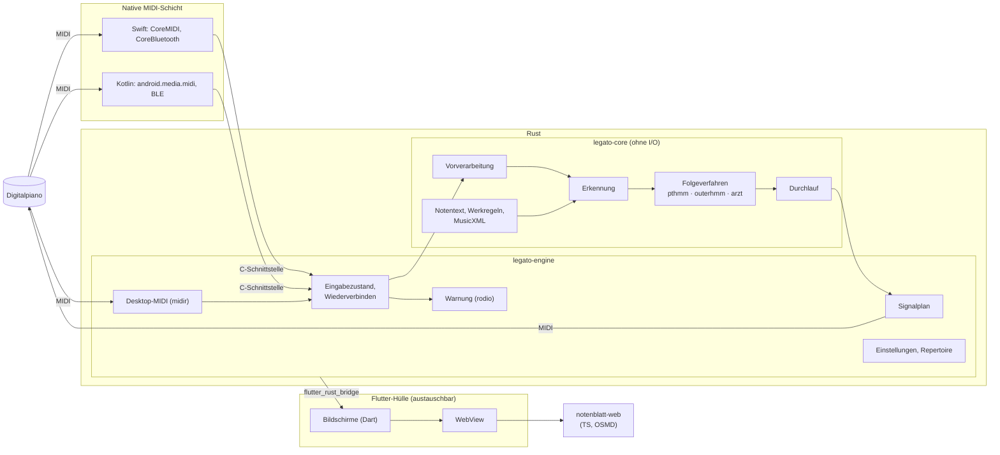

# Implementierungsplan: Legato MVP

**Branch**: `001-legato-mvp` | **Datum**: 2026-10-24 | **Spec**: [spec.md](spec.md) | **Constitution**: [1.0.1](../../.specify/memory/constitution.md)

**Eingabe**: Feature-Spezifikation aus [specs/001-legato-mvp/spec.md](spec.md)

## Zusammenfassung

Das MVP ist eine plattformübergreifende App (Priorität iOS/iPad, dann Android, dann Desktop), die Klavierspiel per MIDI empfängt, Stück, Variation und Tonart selbständig erkennt, dem Spiel im Notenblatt folgt und Durchläufe per MIDI-Signal quittiert. Technisch: Flutter als dünne App-Hülle; die gesamte Fachlogik in Rust (Kern und Engine), damit App, Backend und Web-App dieselben Algorithmen ausführen. Die Verfahren für die Zuordnung werden aus Matchmaker nach Rust portiert und gegen Matchmaker getestet. MIDI läuft über eine eigene native Schicht (Swift, Kotlin) direkt in die Engine. Die Architektur hält einen späteren Wechsel zu Tauri offen. Details: [research.md](research.md).

## Technischer Kontext

**Sprache/Version**: Rust (stable, Edition 2024) für Kern und Engine; Dart 3 / Flutter (stable) für die Oberfläche; Swift 5.9+ (iOS, macOS) und Kotlin (Android) für die MIDI-Schicht; TypeScript 5 für das Notenblatt-Bundle; Python 3.12 nur für das Referenz-Werkzeug

**Wesentliche Abhängigkeiten**: `flutter_rust_bridge`, `quick-xml`, `zip`, `rodio`, `midir` (Desktop), `webview_flutter`, `wakelock_plus`, `path_provider`, OpenSheetMusicDisplay; Referenz: `pymatchmaker` (festgelegter Commit), `partitura`

**Speicherung**: Einstellungen als JSON und Kopien geladener Notendateien in einem App-Verzeichnis, verwaltet von der Engine. Keine Speicherung von Durchläufen (folgt in 003).

**Tests**: `cargo test` (Kern gegen Matchmaker-Referenz und eigene Referenzdaten; Engine mit simuliertem MIDI-Port); plattformübergreifender Testsatz auf iOS-Simulator, Android-Emulator, Linux, WebAssembly; `flutter test`; Vitest; manuelle Abnahme laut [quickstart.md](quickstart.md)

**Zielplattformen**: iOS/iPadOS 16+, Android 9+ (API 28), macOS 12+, Windows 10+, Linux (x86_64)

**Projekttyp**: plattformübergreifende App mit portablem Rust-Kern

**Leistungsziele**: Latenz vom Anschlag bis zur Anzeige ≤ 50 ms (95 %), nie > 100 ms (NFR-003); Kern ≤ 2 ms pro Ton bei 36 Kandidaten; Scrollen und Markierung mit 60 fps

**Rahmenbedingungen**: vollständig offline (NFR-002); Warnung binnen 2 s nach Meldung der Trennung (SC-003); Zuordnung ≥ 99 % (SC-001); plattformübergreifend identische Ergebnisse im Rahmen der Toleranzen aus [R2](research.md#r2--gemeinsamer-kern-in-rust); keine Fachlogik in Dart ([R3](research.md#r3--austauschbarkeit-des-frameworks-flutter--tauri))

**Umfang**: 4 User Stories, 1 mitgeliefertes Stück, ca. 5 Bildschirme (Notenblatt, Eingabe-Auswahl, Repertoire, Einstellungen, Experteneinstellungen), 2 Sprachen, 3 portierte Folgeverfahren

## Constitution Check

*GATE: vor Phase 0 geprüft, nach Phase 1 erneut geprüft.*

| Prinzip | Prüfung | Ergebnis |
|---|---|---|
| I. Zurückhaltung | Während eines Durchlaufs erhält die Oberfläche nur Position, optional dezente Fehlermarkierung und Eingabezustand ([contracts/engine-schnittstelle.md](contracts/engine-schnittstelle.md)); fließende Animationen ([R7](research.md#r7--notendarstellung)); keine Benachrichtigungen | ✅ |
| II. Freiheit der Interpretation | Zuordnung ohne Tempovorgabe; Wiederholungen beliebig; Tonart frei laut Werkregel | ✅ |
| III. Offline zuerst | Keine Netzwerkzugriffe in 001; Repertoire lokal | ✅ |
| IV. Für Fortgeschrittene | Keine Erklärungen in der Oberfläche | ✅ |
| V. Präzision | Eigene native MIDI-Schicht, Treiber-Zeitstempel; Latenzbudget ≤ 50 ms ([R9](research.md#r9--latenz-nfr-003)) | ✅ |
| VI. Nachvollziehbare Bewertung | Kern deterministisch; jede Abweichung trägt Note, Hand und Finger | ✅ |
| VII. Datensparsamkeit | Keine Datenübertragung | ✅ |
| VIII. Plattformübergreifende Konsistenz | Ein Rust-Kern für App, Backend und Web-App; Toleranzen festgelegt und plattformübergreifend getestet ([R2](research.md#r2--gemeinsamer-kern-in-rust), [R13](research.md#r13--tests)) | ✅ |
| Testbarkeit | Referenzdaten aus Matchmaker und eigene Referenz-Durchläufe; Tests vor bzw. mit der Implementierung | ✅ |
| Einfachheit | Monorepo; Werkregeln als Code; drei Folgeverfahren (FR-032 verlangt mehrere). Zusätzliche Schichten (Engine, native MIDI, Web-Bundle) sind begründet, siehe Komplexitätsnachweis | ✅ |
| Lizenzen | Flutter BSD-3, `flutter_rust_bridge` MIT, OSMD BSD-3, Matchmaker Apache-2.0 (Herkunftshinweis, `NOTICE`); Lizenz jeder weiteren Abhängigkeit wird vor Aufnahme geprüft | ✅ |

**Nach Phase 1**: Datenmodell und Contracts führen keine weiteren Abhängigkeiten ein. Keine Verstöße.

**SOLL-Anforderungen** (FR-027 bis FR-029): werden vollständig umgesetzt.

## Architektur



- **`legato-core`**: reine Logik ohne I/O; läuft identisch in App, Backend (007) und Web-App (008).
- **`legato-engine`**: Laufzeit um den Kern: Eingabezustand und Wiederverbinden, Zeitgeber, Signale, Warnung, Persistenz, Desktop-MIDI. Öffentliche, framework-neutrale Schnittstelle ([contracts/engine-schnittstelle.md](contracts/engine-schnittstelle.md)) und C-Schnittstelle für die native MIDI-Schicht ([contracts/native-midi.md](contracts/native-midi.md)).
- **Native MIDI-Schicht**: Swift-Package und Kotlin-Bibliothek ohne Flutter-Abhängigkeit; Gerätesuche, Verbinden, Wiederverbinden, Treiber-Zeitstempel.
- **`notenblatt-web`**: eigenständiges Web-Bundle für Notenbild, Markierungen und Scrollen.
- **Flutter-Hülle**: Bildschirme, Adapter (`flutter_rust_bridge`, Bildschirmsperre, Lebenszyklus). Einziger Teil, der bei einem Wechsel zu Tauri neu entsteht.

## Projektstruktur

### Dokumentation (dieses Feature)

```text
specs/001-legato-mvp/
├── spec.md
├── plan.md              # dieser Plan
├── research.md          # Phase 0
├── data-model.md        # Phase 1
├── quickstart.md        # Phase 1
├── contracts/           # Phase 1
│   ├── engine-schnittstelle.md
│   ├── native-midi.md
│   ├── notendatei.md
│   ├── matchmaker-referenz.md
│   └── referenzdaten.md
└── tasks.md             # Phase 2 (/speckit-tasks)
```

### Quellcode (Repository-Wurzel)

```text
Cargo.toml                       # Cargo-Workspace: core, engine, app/rust
NOTICE                           # Herkunft portierter Matchmaker-Teile
core/                            # legato-core
├── src/
│   ├── notentext/               # Modell, MusicXML lesen und erzeugen
│   ├── werke/                   # Werkregel-Trait, allgemein.rs, hanon.rs
│   ├── vorverarbeitung.rs       # Pedal, Echo
│   ├── folge/                   # Folgeverfahren-Trait, pthmm.rs, outerhmm.rs, arzt.rs
│   ├── erkennung.rs             # Kandidaten, Entscheidung
│   └── durchlauf.rs             # Zustände, Abbruch, Abweichungen
└── tests/
    ├── matchmaker/              # 1:1 übertragene Tests, Vergleich mit Erwartungsdateien
    └── referenz/                # eigene Referenz-Durchläufe (SC-001, SC-002)
engine/                          # legato-engine
├── src/
│   ├── api.rs                   # framework-neutrale Schnittstelle
│   ├── ffi.rs                   # C-Schnittstelle für native MIDI-Schicht
│   ├── eingabe/                 # Eingabezustand, Wiederverbinden, midir (Desktop)
│   ├── signale.rs
│   ├── warnung.rs
│   └── speicher.rs              # Einstellungen, Repertoire
└── tests/                       # simulierter MIDI-Port, SC-003
native/
├── apple/LegatoMidi/            # Swift-Package (iOS, macOS)
└── android/legato-midi/         # Kotlin-Bibliothek
notenblatt-web/                  # TypeScript, OSMD, Vitest
app/                             # Flutter-Hülle
├── lib/                         # Bildschirme, Adapter
├── l10n/                        # app_en.arb, app_de.arb
├── rust/                        # flutter_rust_bridge-Anbindung an engine
├── assets/                      # hanon-01.musicxml, warnung.wav, notenblatt-web (Build)
├── ios/ android/ macos/ windows/ linux/
└── test/
tools/
└── matchmaker-referenz/         # Python (uv): erzeugt Erwartungsdateien
testdaten/
├── matchmaker/                  # übernommene Matchmaker-Daten und Erwartungsdateien
└── legato/                      # eigene Referenz-Durchläufe
```

**Strukturentscheidung**: Monorepo. Kern und Engine sind eigene Crates, damit sie unabhängig vom Framework getestet und in Backend und Web-App wiederverwendet werden. Die native MIDI-Schicht und das Notenblatt-Bundle sind bewusst von Flutter getrennt (R3).

## Reihenfolge und Spikes

| Spike | Frage | Wenn nicht erfüllt |
|---|---|---|
| **S1** (zuerst) | Native MIDI-Schicht auf iOS, dann Android: Trennung und Wiederkehr rechtzeitig erkannt? Bluetooth selbständig wiederverbunden? Latenz, Jitter, Instrument-Zeitstempel? | Manuellen Weg laut FR-006 umsetzen; Grenzen je Plattform dokumentieren; Auswirkung auf 002 bewerten |
| **S3** | Portierte `pthmm`/`outerhmm` stimmen mit Matchmaker überein; mit Erweiterungen SC-001 (≥ 99 %) und SC-002 erreicht? | Fehlermodell anpassen; `arzt` als Standard prüfen |
| **S2** | `notenblatt-web` im WebView auf iPad und Android flüssig (60 fps) und mit geringer Nachrichtenlatenz? | Markierung nativ in Flutter über dem WebView; letzte Option Tauri |

S1 und S3 sind unabhängig vom Framework und können parallel laufen.

## Komplexitätsnachweis

| Zusätzliche Schicht | Warum nötig | Einfachere Alternative verworfen, weil |
|---|---|---|
| Engine getrennt vom Kern | Kern bleibt ohne I/O für Backend und WebAssembly; Engine kapselt Geräte und Zeit | Alles in einem Crate würde Backend und Web-App mit Geräte-Code belasten |
| Eigene native MIDI-Schicht | Bluetooth-Wiederverbinden (FR-006) und Treiber-Zeitstempel müssen steuerbar sein; Unabhängigkeit vom Framework | `flutter_midi_command` bindet MIDI an Dart und steuert Wiederverbinden nicht |
| Notenblatt als Web-Bundle | Kein MusicXML-Renderer für Flutter; Wiederverwendung in Tauri und Web-App | Eigene Flutter-Darstellung zu aufwendig |
