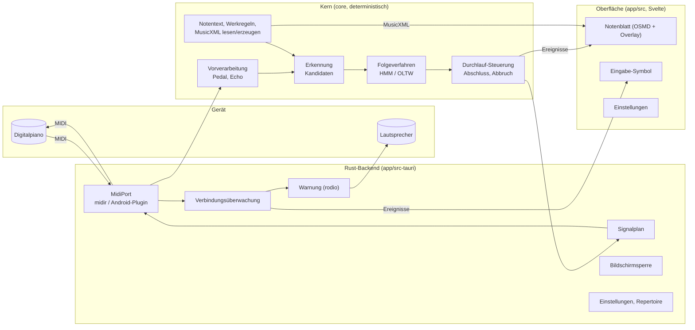

# Implementierungsplan: Legato MVP

**Branch**: `001-legato-mvp` | **Datum**: 2026-10-24 | **Spec**: [spec.md](spec.md)

**Eingabe**: Feature-Spezifikation aus [specs/001-legato-mvp/spec.md](spec.md)

## Zusammenfassung

Das MVP ist eine plattformübergreifende App (iOS, Android, Windows, macOS, Linux), die Klavierspiel per MIDI empfängt, Stück, Variation und Tonart selbständig erkennt, dem Spiel im Notenblatt folgt und Durchläufe per MIDI-Signal quittiert. Technisch: Tauri 2 mit einem deterministischen Rust-Kern (Notentext, Werkregeln, Zuordnung, Erkennung), einem Rust-Backend für Geräte (MIDI, Lautsprecher, Bildschirmsperre, Einstellungen) und einer Svelte-Oberfläche mit OpenSheetMusicDisplay. Die Zuordnung orientiert sich an Matchmaker; Standardverfahren ist ein HMM nach Nakamura et al. (2014). Details und Begründungen: [research.md](research.md).

## Technischer Kontext

**Sprache/Version**: Rust (stable, Edition 2024) für Kern und Backend; TypeScript 5 für die Oberfläche; Kotlin für das Android-MIDI-Plugin, Swift für iOS-Plugins

**Wesentliche Abhängigkeiten**: Tauri 2, `midir`, `rodio`, `keepawake`, `quick-xml`, `zip`, `tauri-plugin-store`, `tauri-plugin-os`; Svelte 5, Vite, OpenSheetMusicDisplay, `svelte-i18n` (alle MIT, Apache-2.0 oder BSD-3-Clause)

**Speicherung**: Einstellungen als JSON (`tauri-plugin-store`); geladene Notendateien als Kopie im App-Datenverzeichnis. Keine Speicherung von Durchläufen (folgt in 003).

**Tests**: `cargo test` (Kern mit Referenz-Durchläufen, Backend mit simuliertem MIDI-Port), Vitest, Playwright; manuelle Abnahme laut [quickstart.md](quickstart.md)

**Zielplattformen**: Windows 10+, macOS 12+, Linux (x86_64, WebKitGTK 4.1, ALSA), iOS 16+, Android 9+ (API 28)

**Projekttyp**: plattformübergreifende App (Desktop und Mobil) mit portablem Kern-Crate

**Leistungsziele**: Latenz vom Anschlag bis zur Anzeige ≤ 50 ms (95 %), nie > 100 ms (NFR-003); Kern ≤ 2 ms pro Ton bei 36 Kandidaten; Scrollen und Markierung mit 60 fps

**Rahmenbedingungen**: vollständig offline (NFR-002); Warnung binnen 2 s nach Trennung (SC-003); Zuordnung ≥ 99 % (SC-001); deterministischer Kern ohne Zugriff auf Uhr, Dateisystem oder Zufall

**Umfang**: 4 User Stories, 1 mitgeliefertes Stück, ca. 5 Bildschirme (Notenblatt, Eingabe-Auswahl, Repertoire, Einstellungen, Experteneinstellungen), 2 Sprachen

## Constitution Check

*GATE: vor Phase 0 geprüft, nach Phase 1 erneut geprüft.*

| Prinzip | Prüfung | Ergebnis |
|---|---|---|
| I. Zurückhaltung | Oberfläche erhält während des Durchlaufs nur Position, optional dezente Fehlermarkierung und Eingabezustand ([contracts/kern-schnittstelle.md](contracts/kern-schnittstelle.md)); fließende Animationen ([R6](research.md#r6--notendarstellung)); keine Benachrichtigungen | ✅ |
| II. Freiheit der Interpretation | Zuordnung unabhängig vom Tempo (HMM über Tonhöhen); Wiederholungen beliebig; Tonart frei laut Werkregel | ✅ |
| III. Offline zuerst | Keine Netzwerkzugriffe in 001; Repertoire lokal | ✅ |
| IV. Für Fortgeschrittene | Keine Erklärungen in der Oberfläche | ✅ |
| V. Präzision | MIDI nativ; Latenzbudget ≤ 50 ms ([R8](research.md#r8--latenz-nfr-003)) | ✅ |
| VI. Nachvollziehbare Bewertung | Kern deterministisch (Zeit nur aus Ereignis-Zeitstempeln); jede Abweichung trägt Note, Hand und Finger | ✅ |
| VII. Datensparsamkeit | Keine Datenübertragung; nur Einstellungen und Notendateien lokal | ✅ |
| VIII. Plattformübergreifende Konsistenz | Ein Kern für alle Plattformen, später auch als WebAssembly für 008 | ✅ |
| Einfachheit | Monorepo; Werkregeln als Code statt Konfigurationssprache; nur zwei Folgeverfahren (FR-032 verlangt mehrere) | ✅ |
| Lizenzen | Alle Abhängigkeiten MIT, Apache-2.0 oder BSD-3-Clause; Verovio (LGPL) bewusst nicht verwendet | ✅ |

**Nach Phase 1**: Datenmodell und Contracts führen keine zusätzlichen Abhängigkeiten oder Abstraktionen ein. Keine Verstöße.

**SOLL-Anforderungen** (FR-027 bis FR-029): werden vollständig umgesetzt; keine Abweichung zu begründen.

## Architektur



- **Kern** (`core/`, Crate `legato-core`): reine Logik ohne I/O. Eingabe: Ereignisse mit Zeitstempel; Ausgabe: Positionen, Abweichungen, Durchlauf-Ereignisse. Läuft identisch in Tests, in der App und später als WebAssembly.
- **Backend** (`app/src-tauri/`, Crate `legato-app`): Geräte, Lebenszyklus, Persistenz; reicht MIDI-Ereignisse in einem eigenen Thread an den Kern und Ergebnisse als Tauri-Ereignisse an die Oberfläche.
- **Oberfläche** (`app/src/`): Darstellung und Bedienung; keine Fachlogik.

## Projektstruktur

### Dokumentation (dieses Feature)

```text
specs/001-legato-mvp/
├── spec.md
├── plan.md              # dieser Plan
├── research.md          # Phase 0
├── data-model.md        # Phase 1
├── quickstart.md        # Phase 1
├── contracts/           # Phase 1
│   ├── kern-schnittstelle.md
│   ├── notendatei.md
│   └── referenzdaten.md
└── tasks.md             # Phase 2 (/speckit-tasks)
```

### Quellcode (Repository-Wurzel)

```text
Cargo.toml                     # Cargo-Workspace: core, app/src-tauri
core/                          # legato-core
├── src/
│   ├── notentext/             # Modell, MusicXML lesen und erzeugen
│   ├── werke/                 # Werkregel-Trait, allgemein.rs, hanon.rs
│   ├── vorverarbeitung.rs     # Pedal, Echo eigener Signaltöne
│   ├── folge/                 # Folgeverfahren-Trait, hmm.rs, oltw.rs
│   ├── erkennung.rs           # Kandidaten, Entscheidung
│   └── durchlauf.rs           # Zustände, Abbruch, Abweichungen
└── tests/                     # Referenz-Durchläufe, Werkregeln
app/
├── package.json               # Svelte, Vite, OSMD, Vitest, Playwright
├── src/
│   ├── lib/notenblatt/        # OSMD, Overlay, Scrollen
│   ├── lib/eingabe/           # Symbol, Auswahl
│   ├── lib/einstellungen/
│   ├── lib/i18n/              # en.json, de.json
│   └── routes/
├── src-tauri/                 # legato-app
│   ├── src/
│   │   ├── midi/              # MidiPort, midir, Überwachung
│   │   ├── signale.rs
│   │   ├── warnung.rs
│   │   ├── wach.rs
│   │   └── befehle.rs         # Tauri-Befehle und -Ereignisse
│   ├── plugins/
│   │   ├── android-midi/      # Kotlin
│   │   └── mobil-wach/        # Kotlin, Swift
│   └── resources/
│       ├── stuecke/hanon-01.musicxml
│       └── warnung.wav
└── tests/e2e/
tests/referenz/                # Referenzdaten (contracts/referenzdaten.md)
```

**Strukturentscheidung**: Monorepo mit Cargo-Workspace (Kern und Backend) und einer npm-App. Der Kern ist ein eigenes Crate, damit er unabhängig getestet und später für die Web-App (008) nach WebAssembly übersetzt werden kann.

## Risiken und Spikes

| Spike | Frage | Wenn nicht erfüllt |
|---|---|---|
| S1 | Erkennen alle Plattformen Trennung und Wiederkehr eines MIDI-Geräts binnen 2 s? Lässt sich Bluetooth-MIDI (iOS, Android) selbständig wiederverbinden? | Manuellen Weg laut FR-006 umsetzen und je Plattform dokumentieren |
| S2 | Rendert OSMD Hanon Nr. 1 in allen Anzeigevarianten und scrollt flüssig auf einem Android-Mittelklassegerät? | Verovio (Lizenz prüfen) oder vereinfachte eigene Darstellung |
| S3 | Erreicht das HMM ≥ 99 % (SC-001) und SC-002 auf ersten Referenzdaten? | Fehlermodell anpassen, OLTW als Standard prüfen |

## Komplexitätsnachweis

Keine Verstöße gegen die Constitution; nichts zu begründen.
