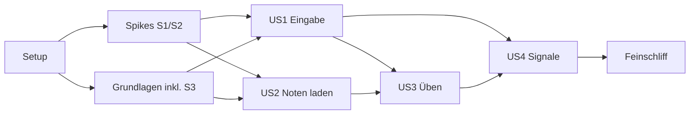

# Tasks: Legato MVP

**Eingabe**: Planungsdokumente aus `specs/001-legato-mvp/` ([plan.md](plan.md), [spec.md](spec.md), [research.md](research.md), [data-model.md](data-model.md), [contracts/](contracts/), [quickstart.md](quickstart.md))

**Tests**: Die Constitution verlangt Tests vor oder zusammen mit der Implementierung (Entwicklungsprinzip „Testbarkeit“). Testaufgaben stehen deshalb in jeder Phase vor der Implementierung und müssen zunächst fehlschlagen.

**Organisation**: Nach Setup, Spikes und Grundlagen folgt je User Story eine Phase. Alle vier Stories haben Priorität P1; die Reihenfolge folgt den fachlichen Abhängigkeiten.

**Sprache**: Beschreibungen deutsch; Pfade, Bezeichner und Schlüssel englisch laut [Glossar](../../docs/glossar.md#bezeichner-im-code).

## Format: `[ID] [P?] [Story] Beschreibung`

- **[P]**: parallel ausführbar (andere Dateien, keine offenen Abhängigkeiten)
- **[Story]**: zugehörige User Story (US1–US4)

---

## Phase 1: Setup

**Zweck**: Repository-Struktur laut [plan.md](plan.md#quellcode-repository-wurzel). Gebaut und getestet wird von Anfang an auf GitHub Actions (öffentliches Repo `Meisterschueler/legato`); lokale Werkzeuge sind nicht nötig.

- [x] T013 CI in `.github/workflows/ci.yml`, vor allen anderen Tasks dieser Phase. Job `generate` (ubuntu) erzeugt, was lokal nicht erzeugt werden kann, und committet es bei Push zurück (bei PR nur Prüfung): Plattform-Ordner per `flutter create`, `flutter_rust_bridge`-Integration und -Bindings, `Cargo.lock`, `pubspec.lock`, `package-lock.json`. Alle weiteren Jobs bauen diesen Stand: `rust` (ubuntu: `cargo fmt --check`, `clippy -D warnings`, `cargo test`, `wasm32`-Build von `legato-core`), `rust-windows` (Engine mit `midir`), `web` (Lint, Vitest, Build), `flutter` (ubuntu: `analyze`, `test`, `build linux`), `android` (`build apk`), `apple` (macos: Swift-Package für macOS und iOS, `flutter build ios --no-codesign`, `build macos`), `windows` (`flutter build windows`)
- [x] T001 Cargo-Workspace mit den Mitgliedern `core`, `engine`, `app/rust` in `Cargo.toml` anlegen; `rust-toolchain.toml` (stable), Edition 2024; `license = "MIT OR Apache-2.0"` für alle Crates
- [x] T002 [P] Crate `legato-core` in `core/Cargo.toml` und `core/src/lib.rs` anlegen; erlaubte Abhängigkeiten nur `quick-xml`, `zip`, `serde` (kein I/O, keine Uhr, kein Zufall)
- [x] T003 [P] Crate `legato-engine` in `engine/Cargo.toml` und `engine/src/lib.rs` anlegen; Abhängigkeiten `legato-core`, `rodio`, `serde_json`, `midir` (nur für Windows- und Linux-Ziele; macOS nutzt das Swift-Package laut contracts/native-midi.md)
- [x] T004 [P] Flutter-App in `app/` anlegen (Plattformen ios, android, macos, windows, linux; Org `io.github.meisterschueler`, Bundle-ID `io.github.meisterschueler.legato`; Plattform-Ordner erzeugt der CI-Job `generate`); in `app/pubspec.yaml` `webview_flutter`, `wakelock_plus`, `path_provider`, `flutter_localizations`, `file_selector` aufnehmen; Lizenz jeder Abhängigkeit prüfen und in `app/LICENSES.md` vermerken
- [x] T005 `flutter_rust_bridge` einrichten: Crate `app/rust/` (abhängig von `legato-engine`), `app/flutter_rust_bridge.yaml`, generierte Dart-Bindings in `app/lib/src/rust/`
- [x] T006 [P] Web-Bundle `score-view-web/` anlegen (Vite, TypeScript, `opensheetmusicdisplay`, Vitest); Build-Ausgabe nach `app/assets/score-view-web/`
- [x] T007 [P] Swift-Package `native/apple/LegatoMidi/Package.swift` anlegen (iOS 16, macOS 12) mit C-Target für den Engine-Header
- [x] T008 [P] Kotlin-Bibliothek `native/android/legato-midi/` anlegen (`build.gradle.kts`, minSdk 28) und in `app/android/settings.gradle` einbinden
- [x] T009 [P] Python-Werkzeug `tools/matchmaker-reference/` mit `pyproject.toml` (pymatchmaker auf festem Commit, partitura; uv) und `README.md` anlegen
- [x] T010 [P] `NOTICE` mit Herkunftshinweis für Matchmaker (Apache-2.0) und `testdata/matchmaker/PROVENANCE.md` anlegen
- [x] T011 [P] Formatierung und Linting: `rustfmt.toml`; `core/clippy.toml` mit `disallowed-types` für `std::collections::HashMap`/`HashSet` (research.md R2); `app/analysis_options.yaml`; ESLint/Prettier in `score-view-web/`
- [x] T012 [P] `.gitignore` für Rust, Flutter, Node und Python ergänzen
- [x] T014 [P] Hanon Nr. 1 als MusicXML in `app/assets/pieces/hanon-01.musicxml` erstellen (gemeinfrei; beide Hände auf zwei Systemen, Fingersatz, Wiederholungszeichen um „Aufwärts“ und „Abwärts“, Schlusston „Ende“; Metadaten `<creator type="composer">Hanon</creator>`, `<movement-number>1</movement-number>`) laut [docs/werke/hanon.md](../../docs/werke/hanon.md)
- [x] T015 [P] Kurzen Warnton als `app/assets/warning.wav` erstellen (gemeinfrei oder selbst erzeugt)

**Checkpoint**: Leere Crates, App, Bundle und native Pakete bauen; CI läuft grün.

---

## Phase 2: Spikes S1 und S2 (unabhängig vom Framework)

**Zweck**: Größte Risiken vor der eigentlichen Umsetzung prüfen ([plan.md](plan.md#reihenfolge-und-spikes)). Der Code der MIDI-Schicht ist kein Wegwerf-Code, sondern wird in US1 weiterverwendet.

### Spike S1: MIDI auf iOS und Android

- [x] T016 C-Schnittstelle laut [contracts/native-midi.md](contracts/native-midi.md) in `engine/src/ffi.rs` als Stub implementieren (Ereignisse mit `time_us` protokollieren); Header mit `engine/cbindgen.toml` nach `engine/include/legato_midi.h` erzeugen
- [x] T017 [P] USB-MIDI über CoreMIDI in `native/apple/LegatoMidi/Sources/LegatoMidi/CoreMidiTransport.swift`: Geräte-Benachrichtigungen (hinzu/weg), Quelle verbinden, Nachrichten mit `MIDITimeStamp` in µs an `legato_midi_message` weiterreichen
- [x] T018 [P] Bluetooth-MIDI über CoreBluetooth in `native/apple/LegatoMidi/Sources/LegatoMidi/BluetoothMidiTransport.swift`: Suche nach dem BLE-MIDI-Dienst, Verbinden, Kennung speichern, dauerhafte Verbindungsanfrage nach Abbruch
- [x] T019 Spike-App `spikes/s1-midi-ios/` (SwiftUI, linkt `LegatoMidi` und die Engine als statische Bibliothek): zeigt Ereignisse, misst Erkennungszeit der Trennung, Wiederverbinden, Latenz und Jitter, exportiert ein Protokoll
- [ ] T020 S1 auf dem iPad messen (USB und Bluetooth, mit vorhandenem Piano bzw. Adapter); Ergebnisse und Folgerungen als „Spike-Ergebnis S1“ in `specs/001-legato-mvp/research.md` (R4) eintragen
- [ ] T021 [P] Android-MIDI in `native/android/legato-midi/src/main/kotlin/io/github/meisterschueler/legato/midi/LegatoMidi.kt`: `MidiManager.DeviceCallback`, BLE-Suche, `openBluetoothDevice`, Berechtigungen `BLUETOOTH_SCAN`/`BLUETOOTH_CONNECT`; JNI-Exporte in `engine/src/ffi/android.rs`
- [ ] T022 Spike-App `spikes/s1-midi-android/`; auf mindestens zwei Geräten verschiedener Hersteller messen und in `specs/001-legato-mvp/research.md` (R4) eintragen, einschließlich Weitergabe der Instrument-Zeitstempel

### Spike S2: Notenblatt im WebView

- [x] T023 [P] Nachrichtenschnittstelle (`load`, `position`, `mark`, `reset`; Rückmeldungen `ready`, `frame_shown`) laut [contracts/engine-schnittstelle.md](contracts/engine-schnittstelle.md#nachrichten-an-score-view-web) in `score-view-web/src/protocol.ts` und Rendering von `hanon-01.musicxml` mit OSMD in `score-view-web/src/main.ts`
- [ ] T024 Spike-Seite `app/lib/spike/score_view_spike.dart`: WebView mit `score-view-web`, synthetische Positionen mit 16 Tönen/s; Bildrate und Nachrichtenlatenz auf iPad und Android messen; Ergebnis in `specs/001-legato-mvp/research.md` (R7) eintragen
- [ ] T106 [P] Notenblatt unter Windows (research.md R7): `webview_windows` in `app/pubspec.yaml` aufnehmen und in `app/LICENSES.md` vermerken; `app/lib/src/score_view/score_view.dart` und `app/lib/spike/score_view_spike.dart` betten unter Windows WebView2 ein; `score-view-web/src/main.ts` sendet Rückmeldungen auch über `window.chrome.webview.postMessage`; Bildrate und Nachrichtenlatenz unter Windows messen und in `specs/001-legato-mvp/research.md` (R7) eintragen

**Checkpoint**: S1 und S2 ausgewertet. Bei negativem Ergebnis Plan anpassen, bevor Phase 4 beginnt.

---

## Phase 3: Grundlagen (blockiert alle User Stories)

**Zweck**: Kern-Modell, Werkregeln, portierte Folgeverfahren (inkl. Spike S3), Engine-Gerüst, Brücke zu Flutter

### Notentext

- [x] T025 [P] Kern-Typen in `core/src/score/model.rs` laut [data-model.md](data-model.md#noten): `Work`, `Piece`, `Score`, `Onset`, `Note`, `NoteId`, `Section`, `Measure`, `Candidate`, `Variation`, `Hand`; Regeln wörtlich: `NoteId` = „`(measure, voice, index)`; stabil, nur intern“; `pitch` = „MIDI-Notennummer, in C-Dur wie notiert“; `hand` = „aus Notensystem (unteres = links)“; `finger` = „1–5“; `successors` = „normal `index + 1`; am Ende eines Wiederholungsabschnitts zusätzlich dessen Anfang (FR-014)“
- [x] T026 [P] Testfälle für den MusicXML-Parser in `core/tests/musicxml_read.rs` mit Dateien in `testdata/legato/musicxml/`: `score-partwise`, `.mxl`, Akkorde, Haltebögen, Pausen, Fingersatz, Wiederholungen, zwei Systeme bzw. zwei Parts; Ablehnungsgründe laut [contracts/notendatei.md](contracts/notendatei.md#ablehnung-us-2-szenario-2)
- [x] T027 MusicXML-Parser für die Teilmenge laut [contracts/notendatei.md](contracts/notendatei.md) in `core/src/score/musicxml_read.rs` (quick-xml, zip); Fehler als `InvalidScoreFile { reason }`
- [x] T028 MusicXML-Writer mit Transposition in `core/src/score/musicxml_write.rs`; liefert zusätzlich die Zuordnung `NoteId` → Anzeige-ID `Takt/System/Einsatz/Tonhöhe` laut [contracts/engine-schnittstelle.md](contracts/engine-schnittstelle.md#nachrichten-an-score-view-web) (Anzeigevarianten folgen in US3)

### Werkregeln

- [x] T029 Trait `WorkRules` (zulässige Kandidaten, Erkennungslänge, Grenzen eines Durchlaufs, Anzeigevarianten, Hand aus Lage) und allgemeine Regeln in `core/src/works/mod.rs` und `core/src/works/generic.rs`: „keine Transposition, Durchlauf = gesamtes Stück, Erkennungslänge 8 Töne je Hand, nur Anzeigevariante ‚komplett‘“
- [x] T030 [P] Tests für die Hanon-Regeln in `core/tests/works_hanon.rs`: Transposition 0–11 Halbtöne für beide Hände gleich; Lage eindeutig aus Tonart; Durchlauf = Wiederholungsabschnitt ohne „Ende“; „Aufwärts“/„Abwärts“ = erste/zweite Hälfte der Takte; Erkennungslänge 8 Töne je Hand; einhändig: Hand aus Lage, Einschränkung (FR-018) hat Vorrang
- [x] T031 Hanon-Regeln in `core/src/works/hanon.rs` und Erkennung des Werks aus Metadaten in `core/src/works/detect.rs`

### Matchmaker-Referenz und Portierung (Spike S3)

- [x] T032 [P] Testdaten aus Matchmaker (`EXAMPLE_MATCH`, `simple_mozart`, `bach_fugue`) nach `testdata/matchmaker/pieces/` übernehmen und in `testdata/matchmaker/PROVENANCE.md` belegen
- [x] T033 `tools/matchmaker-reference/generate.py` laut [contracts/matchmaker-referenz.md](contracts/matchmaker-referenz.md): `note_array`, `intermediates`, `steps` für `pthmm`, `outerhmm`, `arzt`; zusätzlich `note_array` von partitura für `app/assets/pieces/hanon-01.musicxml`
- [x] T034 Erwartungsdateien erzeugen und unter `testdata/matchmaker/expected/` einchecken
- [x] T035 [P] Parser-Test gegen partitura in `core/tests/musicxml_vs_partitura.rs` (Hanon Nr. 1 und Matchmaker-Stücke)
- [x] T036 Trait `ScoreFollower` in `core/src/following/mod.rs` und `Preprocessor` (Tonhöhe je Ton bzw. je Akkord wie bei Matchmaker) in `core/src/preprocessing.rs`; kompatibler Modus mit `note_array` als Eingabe
- [x] T037 Vergleichs-Hilfen in `core/tests/matchmaker/compare.rs`: liest Erwartungsdateien; Toleranzen „`intermediates` relativ 1e-6; `onset_index` ≥ 99 % der Schritte identisch, keine Abweichung > 1“
- [x] T038 [P] Tests aus `tests/test_prob_hmm.py` 1:1 (gleiche Namen und Prüfungen) nach `core/tests/matchmaker/prob_hmm.rs` übertragen, plus Vergleich mit `*.pthmm.json`
- [x] T039 [P] Tests aus `tests/test_prob_outer_product_hmm.py` nach `core/tests/matchmaker/outer_product_hmm.rs` übertragen, plus Vergleich mit `*.outerhmm.json`
- [x] T040 [P] Tests aus `tests/test_oltw_arzt.py` nach `core/tests/matchmaker/oltw_arzt.rs` übertragen, plus Vergleich mit `*.arzt.json`
- [x] T041 [P] `pthmm` nach `core/src/following/pthmm.rs` portieren (Herkunftshinweis Apache-2.0 im Dateikopf)
- [x] T042 [P] `outerhmm` nach `core/src/following/outer_hmm.rs` portieren (Herkunftshinweis)
- [x] T043 [P] `arzt` nach `core/src/following/arzt.rs` portieren (Herkunftshinweis)
- [x] T044 S3 Teil 1 auswerten: alle Vergleiche grün; Ergebnis als „Spike-Ergebnis S3“ in `specs/001-legato-mvp/research.md` (R8) eintragen
- [ ] T045 Plattformübergreifender Lauf des Kern-Testsatzes auf iOS-Simulator, Android-Emulator, Linux, Windows und `wasm32` (wasm-bindgen-test) in `.github/workflows/cross-platform.yml`; Vergleich der Ergebnisse mit den Toleranzen aus research.md R2 in `core/tests/cross_platform.rs`

### Engine und Hülle

- [x] T046 Engine-Laufzeit in `engine/src/runtime.rs`: eine Warteschlange für Befehle und Eingabeereignisse, eingespeiste Uhr (testbar; kommt mit der ersten zeitabhängigen Logik, Warnung in US 1), Ereignisstrom `Event` laut [contracts/engine-schnittstelle.md](contracts/engine-schnittstelle.md); Funktionen `start`, `set_foreground`, `events` in `engine/src/api.rs`
- [x] T047 [P] Tests für `Settings` in `engine/tests/storage.rs`: Standardwerte wörtlich laut [data-model.md](data-model.md#settings-einstellungen-persistiert) (u. a. `pause_limit_ms` 4000, `rest_limit_ms` 10000, `ok_signal` `WhenStopped`, `abort_signal` `Immediately`, `connect_signal` `On`, Fehlermarkierung aus); Speichern und Laden als JSON in `data_dir`
- [x] T048 `Settings` und Speicherung in `engine/src/storage.rs`; `get_settings`/`set_settings` in `engine/src/api.rs`; Änderungen wirken ab dem nächsten Durchlauf
- [x] T049 [P] Simulierter MIDI-Port für Tests in `engine/src/input/sim.rs` (Gerät hinzu/weg, Nachrichten mit Zeitstempel, gesendete Nachrichten mitschneiden)
- [x] T050 Engine-Schnittstelle über `flutter_rust_bridge` in `app/rust/src/api.rs` freigeben; Dart-Wrapper ohne Fachlogik in `app/lib/src/engine/engine_client.dart`
- [x] T051 [P] Mehrsprachigkeit: `app/l10n.yaml`, `app/l10n/app_en.arb`, `app/l10n/app_de.arb`; Sprache aus der Regionseinstellung, Englisch als Fallback für nicht unterstützte Sprachen und einzelne fehlende Texte (NFR-006) in `app/lib/src/l10n/locale_resolution.dart`
- [x] T052 [P] Test für NFR-006 in `app/test/locale_resolution_test.dart`: `de-AT` → Deutsch, `fr-FR` → Englisch
- [x] T053 App-Gerüst in `app/lib/main.dart` und `app/lib/src/practice/practice_screen.dart`: Engine starten (`data_dir` über `path_provider`), Platz für Notenblatt und Eingabe-Symbol

**Checkpoint**: Kern parst Hanon Nr. 1, Werkregeln und portierte Verfahren sind gegen Matchmaker geprüft, Engine läuft hinter der Flutter-Hülle.

---

## Phase 4: User Story 1 – Eingabe wählen und MIDI-Verbindung überwachen (P1)

**Ziel**: Zuverlässige MIDI-Verbindung mit Warnung, automatischem Wiederverbinden und Statussymbol

**Unabhängiger Test**: Während eines Durchlaufs und zwischen zwei Durchläufen die MIDI-Verbindung trennen und wiederherstellen; Warnung, automatische Wiederverbindung und Statusanzeige prüfen (quickstart.md Nr. 2, 7, 8, 9, 13, 15, 16).

### Tests für User Story 1

- [x] T054 [P] [US1] Tests in `engine/tests/input_state.rs` mit simuliertem Port: Trennung → `DisconnectWarning` sofort sowie nach 10 s und 30 s, sofern nicht wiederverbunden oder bestätigt, danach keine weitere akustische Warnung; `vibrate` wird mit jeder Warnung aufgerufen; Warnung binnen 2 s nach Meldung des Betriebssystems (SC-003); automatisches Wiederverbinden; laufender Durchlauf wird bei Trennung, Eingabewechsel und Hintergrund verworfen; kein Wechsel zu Audio; ohne gewählte Eingabe keine Zuordnung und keine Warnung; Wiederherstellen der zuletzt gewählten Eingabe beim Start (Verwerfen des Durchlaufs folgt mit T084; Warnton und Vibration sind ein Aufruf `warn`)
- [x] T055 [P] [US1] Widget-Tests in `app/test/input_symbol_test.dart`: Zustände unterscheiden sich in der Form; klein bei verbunden, deutlich bei nicht verbunden/abgebrochen; gleiche Position in allen Ansichten; Antippen öffnet die Auswahl

### Implementierung für User Story 1

- [x] T056 [US1] Zustandsmaschine `InputState` (`Disconnected` → `MidiConnected` ↔ `ConnectionLost`, `warning_acknowledged`) in `engine/src/input/state.rs`
- [x] T057 [US1] Geräteverwaltung in `engine/src/input/state.rs`: Geräte aus FFI bzw. `midir`, `list_inputs`, `select_input`, `reconnect`, `scan_bluetooth`; gewählte Eingabe in `Settings` speichern und beim Start wiederherstellen (FR-002)
- [x] T058 [P] [US1] MIDI unter Windows und Linux mit `midir` (unter Windows Feature `winrt`, damit in Windows gekoppelte Bluetooth-MIDI-Geräte erscheinen) und Abfrage der Portliste alle 250 ms in `engine/src/input/midir_desktop.rs`
- [x] T105 [US1] Spike S1 unter Windows (nach T058): Diagnoseprogramm `engine/examples/midi_probe.rs` protokolliert Geräte und Ereignisse mit Zeitstempel; mit einem gekoppelten Bluetooth-MIDI-Gerät und per USB Erkennung von Trennung und Wiederkehr, automatisches Wiederverbinden, Latenz und Jitter messen; Ergebnis als „Spike-Ergebnis S1 unter Windows“ in `specs/001-legato-mvp/research.md` (R4) eintragen
- [x] T107 [US1] Zeitstempel unter Windows korrigieren in `engine/src/input/midir_desktop.rs` (Spike-Ergebnis S1 unter Windows): weicht der Abstand zweier Treiber-Zeitstempel um mehr als 1 s vom Abstand der Ankunftszeiten ab oder beginnt eine neue Verbindung, wird die Zeit an der Ankunftszeit neu ausgerichtet; Test mit den gemessenen Folgen (Sprung um +8,1 s, Neubeginn nach Wiederverbinden)
- [ ] T059 [US1] C-Schnittstelle vollständig umsetzen (Stub aus T016 ersetzen) in `engine/src/ffi.rs` und `engine/src/ffi/android.rs`; Funde aus `legato_midi_bluetooth_found` als Ereignis `BluetoothDeviceFound`; `scan_bluetooth` an die Bridge (`app/rust/src/api/engine.rs`) geben und die Bluetooth-Suche mit den Funden in der Eingabe-Auswahl (T064) anbieten
- [x] T060 [US1] Warnung über den Lautsprecher mit `rodio` in `engine/src/warning.rs`: spielt `warning.wav` sofort sowie nach 10 s und 30 s, ruft jeweils `vibrate` der nativen Schicht auf, endet bei Wiederverbindung oder `acknowledge_warning` (FR-005)
- [ ] T061 [US1] `LegatoMidi` in `app/ios/Runner/AppDelegate.swift` und `app/macos/Runner/AppDelegate.swift` registrieren; Audio-Session `playback` + `mixWithOthers`; `vibrate` (iPhone: `kSystemSoundID_Vibrate`, iPad: ohne Wirkung); `NSBluetoothAlwaysUsageDescription` in `app/ios/Runner/Info.plist`
- [ ] T062 [US1] `legato-midi` in `app/android/app/src/main/kotlin/.../MainActivity.kt` registrieren; `vibrate` über `Vibrator`; Berechtigungen (inkl. `VIBRATE`) in `app/android/app/src/main/AndroidManifest.xml`
- [x] T063 [P] [US1] Eingabe-Symbol in `app/lib/src/input/input_symbol.dart` (Zustände laut US 1 Szenario 10, fließende Übergänge)
- [x] T064 [US1] Eingabe-Auswahl in `app/lib/src/input/input_picker.dart`: verfügbare MIDI-Geräte, aktuelle Wahl, Anzeige ob Eingaben ankommen, Warnung bestätigen, neu verbinden (US 1 Szenarien 11, 15); unter Windows ein Verweis auf die Bluetooth-Einstellungen von Windows (research.md R4); die Bluetooth-Suche der Mobilplattformen folgt mit T059
- [x] T065 [P] [US1] Bildschirmsperre verhindern, solange eine Übeeinheit läuft (Ereignis `PracticeSessionChanged`, sendet die Engine ab T084), in `app/lib/src/platform/wakelock_adapter.dart` (NFR-005)
- [x] T066 [US1] Lebenszyklus an die Engine melden (`set_foreground`) und `BackgroundNotice` anzeigen in `app/lib/src/platform/lifecycle_adapter.dart` (US 1 Szenario 8)

**Checkpoint**: Verbinden, Trennen, Warnen und Wiederverbinden funktionieren unter Windows (USB und Bluetooth), auf iPad und Android; Symbol zeigt den Zustand.

---

## Phase 5: User Story 2 – Noten aus einer Datei laden (P1)

**Ziel**: Stücke aus lokalen Dateien laden; Hanon Nr. 1 ist mitgeliefert

**Unabhängiger Test**: Eine gültige und eine ungültige Notendatei laden und Anzeige bzw. Fehlermeldung prüfen (quickstart.md Nr. 1, 10).

### Tests für User Story 2

- [x] T067 [P] [US2] Tests in `engine/tests/repertoire.rs`: gültige Datei → `PieceInfo`; ungültige Datei → `InvalidScoreFile { reason }`; Datei ohne Fingersatz → `has_fingering = false`; neu installiert → Repertoire enthält genau Hanon Nr. 1 (FR-010); geladene Datei bleibt nach Neustart erhalten
- [x] T068 [P] [US2] Widget-Test in `app/test/repertoire_screen_test.dart`: Fehlermeldung verständlich, App bleibt bedienbar; Kennzeichnung fehlender Fingersatz

### Implementierung für User Story 2

- [x] T069 [US2] Repertoire in `engine/src/repertoire.rs`: mitgeliefertes Hanon Nr. 1 aus `resource_dir`; geladene Dateien nach `data_dir/pieces/` kopieren; `Piece.id` = Hash des Dateiinhalts; `load_piece`, `repertoire`, `render_score` (ohne Anzeigevarianten) in `engine/src/api.rs`
- [x] T070 [US2] Repertoire-Bildschirm mit Dateiauswahl (`file_selector`) in `app/lib/src/repertoire/repertoire_screen.dart`; Fehlermeldungen aus den ARB-Dateien
- [x] T071 [US2] Notenblatt-Widget in `app/lib/src/score_view/score_view.dart`: bettet `score-view-web` im WebView ein, sendet `load` mit dem MusicXML aus `render_score`

**Checkpoint**: Hanon Nr. 1 und eigene Dateien werden angezeigt; fehlerhafte Dateien werden verständlich abgelehnt.

---

## Phase 6: User Story 3 – Üben mit MIDI und Notenblatt (P1) 🎯 Kern des MVP

**Ziel**: Erkennung von Stück, Variation und Tonart; ruhige Positionsmarke; Abbruch bei Pause oder Zuordnungsverlust

**Unabhängiger Test**: Ein Stück laden, mit MIDI-Gerät spielen (oder aufgezeichnete MIDI-Datei einspeisen) und prüfen, dass die Positionsmarkierung dem Spiel folgt; Durchläufe mit langen Pausen und mit Zuordnungsverlust einspeisen und den Abbruch prüfen (quickstart.md Nr. 3, 5, 6, 11, 14).

### Referenzdaten und Tests für User Story 3

- [ ] T072 [P] [US3] Generator für synthetische Durchläufe mit bekannter Zuordnung in `core/tests/support/synth.rs`: Tempo und Agogik variabel, eingestreute Auslassungen/falsche Töne/Zusatztöne, Pausen, Pedal, kurzzeitiger Tonartwechsel, einhändig, nahtlose Wiederholungen
- [ ] T073 [US3] Echte Referenz-Durchläufe von Hanon Nr. 1 aufnehmen und von Hand zuordnen laut [contracts/referenzdaten.md](contracts/referenzdaten.md#mindestumfang) in `testdata/legato/hanon-01/`
- [ ] T074 [P] [US3] Tests in `core/tests/recognition.rs`: richtiger Kandidat spätestens nach der Erkennungslänge (SC-002); Einschränkung (FR-018) wird beachtet; Töne vor der Erkennung gehören zum Durchlauf; ohne eindeutige Erkennung kein Durchlauf; nach `Completed` werden Wiederholung und Wechsel erkannt (US 3 Szenario 2)
- [ ] T075 [P] [US3] Tests in `core/tests/performance_lifecycle.rs`: Abbruch nach `PauseLimit` außerhalb notierter Pausen; Warten bis `RestLimit` an notierten Pausen; Abbruch bei `AlignmentLoss` (< 30 % der letzten *n* Töne zugeordnet); kurzzeitiger Tonartwechsel ergibt Abweichungen, kein Wechsel des Kandidaten; Pedal (CC 64) ohne Einfluss; einhändig keine Auslassungen der anderen Hand; dieselbe Zuordnung bei 0,5- bis 3-fachem Tempo und mit Agogik (FR-017)
- [ ] T076 [P] [US3] Messung SC-001 in `core/tests/reference_sc001.rs` über alle Referenzdaten (synthetisch und echt); Ziel ≥ 99 %
- [ ] T077 [P] [US3] Tests in `score-view-web/test/score_view.test.ts`: Positionsmarke folgt `position`; Fehlermarkierung über `mark`; Scrollen hält die nächste Zeile sichtbar; Wechsel der Anzeigevariante behält die Position; Übergänge 150–400 ms, nie sofort gesetzt; bei `prefers-reduced-motion` Überblenden statt Bewegung (FR-023)
- [ ] T102 [P] [US3] Benchmark in `core/benches/following.rs` (criterion): Kern ≤ 2 ms pro Ton bei 36 Kandidaten (plan.md „Leistungsziele“) auf Desktop und über den plattformübergreifenden Lauf (T045) auf iOS/Android
- [ ] T103 [P] [US3] Test in `app/test/no_interruptions_test.dart`: während eines simulierten Durchlaufs erscheinen keine Meldungen, Dialoge oder Animationen außer den in FR-024 erlaubten (SC-004)

### Implementierung für User Story 3

- [ ] T078 [US3] Wiederholungen als Kanten im Zustandsgraph (statt Auflösung) für alle drei Verfahren in `core/src/following/repeats.rs`
- [ ] T079 [US3] Einordnung der Abweichungen (`Omission`, `Substitution`, `Addition` mit Note, Hand, Finger) in `core/src/following/deviations.rs`; in `engine/src/session.rs` das Ereignis `DeviationDetected` (nur wenn Fehlermarkierung während des Spiels an) und `deviations` in `PerformanceEnded`
- [x] T080 [US3] Pedal-Filter (CC 64 verwerfen) in `core/src/preprocessing.rs` (FR-003)
- [x] T081 [US3] Erkennung mit parallel verfolgten Kandidaten, Entscheidung über a-posteriori-Schwelle und Abstand zum Zweitbesten mit den Startwerten aus research.md R8 (≥ 4 Töne je Hand, ≥ 0,95, ≥ 20 : 1; spätestens nach der Erkennungslänge bei ≥ 0,5), spätestens nach der Erkennungslänge, in `core/src/recognition.rs`
- [x] T082 [US3] Zustandsmaschine `PerformanceState` (`Recognizing`, `Running`, `Completed`, `Aborted`) mit `PauseLimit`, `RestLimit` und `AlignmentLoss` in `core/src/performance.rs` laut [data-model.md](data-model.md#performance-durchlauf)
- [ ] T083 [US3] Anzeigevarianten für Hanon (komplett; erste und letzte zwei Takte je Teil mit *simile*; erster Takt von „Aufwärts“ und „Abwärts“ in getrennten Systemen; nur erster Takt von „Aufwärts“) in `core/src/score/musicxml_write.rs` (FR-011)
- [x] T084 [US3] Sitzung in `engine/src/session.rs`: MIDI-Ereignisse → Kern; Ereignisse `PerformanceRecognized`, `Position`, `PerformanceEnded` (Abweichungen mit T079); Sperre aller anderen Meldungen während eines Durchlaufs (FR-024, geprüft mit T103); Eingabe getrennt oder gewechselt sowie Wechsel in den Hintergrund brechen den laufenden Durchlauf ab (FR-002, FR-004, NFR-005); Übeeinheit beginnt mit dem ersten Ton und endet nach `session_idle_timeout_ms` ohne Ton, beim Beenden oder im Hintergrund (Ereignis `PracticeSessionChanged`)
- [ ] T085 [US3] Positionsmarke und Scrollen mit `requestAnimationFrame`, flüssige Farbwechsel (150–400 ms), Überblenden bei „Bewegung reduzieren“, dezente Fehlermarkierung während bzw. nach dem Durchlauf in `score-view-web/src/markers.ts` und `score-view-web/src/scroll.ts` (FR-023, FR-025)
- [ ] T086 [US3] Ereignisse der Engine an `score-view-web` weiterreichen und Anzeigevariante wechseln in `app/lib/src/score_view/score_view.dart` (US 3 Szenario 18)
- [ ] T087 [P] [US3] Einstellungen in `app/lib/src/settings/settings_screen.dart`: Grenzzeiten (FR-020), Fehlermarkierung während/nach je Abweichungsart (FR-025), Einschränkung der Erkennung (FR-018), Anzeigevariante (FR-011)
- [ ] T088 [P] [US3] Experteneinstellungen mit Auswahl des Folgeverfahrens (`Pthmm`, `OuterHmm`, `Arzt`) in `app/lib/src/settings/expert_settings_screen.dart` (FR-032)
- [ ] T089 [US3] S3 Teil 2: Verfahren mit Erweiterungen gegen SC-001 und SC-002 messen; Standardverfahren festlegen und in `specs/001-legato-mvp/research.md` (R8) sowie als Standard in `engine/src/storage.rs` und [data-model.md](data-model.md) eintragen

**Checkpoint**: Hanon Nr. 1 wird in beliebiger Tonart, beid- und einhändig erkannt und verfolgt; Abbrüche funktionieren; SC-001 und SC-002 erfüllt.

---

## Phase 7: User Story 4 – Akustisches Signal am Ende eines Durchlaufs (P1)

**Ziel**: Neutrale MIDI-Signale für Verbindung, abgeschlossene und abgebrochene Durchläufe

**Unabhängiger Test**: Referenz-Durchläufe einspeisen, die abgeschlossen bzw. abgebrochen werden, teils nahtlos aufeinander folgend, und die an den MIDI-Ausgang gesendeten Töne prüfen (quickstart.md Nr. 2, 4, 5).

### Tests für User Story 4

- [ ] T090 [P] [US4] Tests in `engine/tests/signals.rs` mit simuliertem Port für alle Szenarien von US 4: „nach jedem Durchlauf“; „wenn der Pianist aufgehört hat“ genau einmal nach fünf nahtlosen Durchläufen; kein OK-Signal ohne abgeschlossenen Durchlauf seit dem letzten; Abbruch-Signal sofort; nachgespielte Töne ohne neuen Durchlauf sind kein Abbruch; kein Senden bei getrennter Verbindung oder ohne MIDI-Ausgang; Verbindungssignal bei Verbinden, Wiederverbinden und Wiederherstellen beim Start; identische Signale unabhängig von der Qualität; Änderungen ab dem nächsten Durchlauf
- [ ] T091 [P] [US4] Tests in `core/tests/echo_filter.rs`: eingehende Note-On-Ereignisse mit einer in den letzten 300 ms selbst gesendeten Tonhöhe werden verworfen (FR-030)

### Implementierung für User Story 4

- [ ] T092 [US4] Erkennung von „Aufhören“ (Stille länger als `PauseLimit` nach einem abgeschlossenen Durchlauf; Töne ohne neuen Durchlauf zählen nicht als Weiterspielen) als Ereignis `Stopped` in `core/src/performance.rs`
- [ ] T093 [US4] Echo-Filter mit Register der gesendeten Töne in `core/src/preprocessing.rs`; Engine meldet gesendete Töne in `engine/src/session.rs`
- [ ] T094 [US4] `SignalPlanner` in `engine/src/signals.rs`: `ConnectSignal`, `OkSignal`, `AbortSignal` laut Einstellungen; Standard-Tonfolgen „höchstens 2 Töne, leise (Velocity 30), hohe Lage (C7/E7)“, aufsteigend für OK, absteigend für Abbruch, gleichbleibend für Verbindung; Ausgabe an das gewählte Gerät (US 1 Szenario 14)
- [ ] T095 [P] [US4] Signal-Einstellungen (an/aus bzw. Modus, Tonfolge, Lautstärke) in `app/lib/src/settings/signal_settings.dart`

**Checkpoint**: Alle vier User Stories funktionieren zusammen; MVP vollständig.

---

## Phase 8: Feinschliff und Querschnitt

- [ ] T096 [P] Latenzmessung in Entwicklungs-Builds: `driver_time_us` bis `frame_shown` protokollieren und auswerten in `app/lib/src/dev/latency_log.dart` und `score-view-web/src/latency.ts` (NFR-003: 95 % ≤ 50 ms, Maximum ≤ 100 ms)
- [ ] T097 [P] Prüfen, dass die App keine Benachrichtigungen anfordert oder versendet (SC-005, FR-026): keine Push-Berechtigungen in `app/ios/Runner/Info.plist` und `app/android/app/src/main/AndroidManifest.xml`; Test in `app/test/no_notifications_test.dart`
- [ ] T098 [P] Lizenzen aller Abhängigkeiten zusammenstellen und in der App anzeigen (`app/lib/src/about/licenses_screen.dart`, inkl. `NOTICE`)
- [x] T099 Projektlizenz festlegen: „MIT OR Apache-2.0“ (`LICENSE-MIT`, `LICENSE-APACHE`; verträglich mit Apache-2.0 und BSD-3 der Abhängigkeiten)
- [ ] T100 [P] `README.md` um Aufbau des Repositories, Build und Tests ergänzen (Verweis auf [quickstart.md](quickstart.md))
- [ ] T104 [P] Offline-Fähigkeit prüfen (NFR-002): keine Netzwerkzugriffe in `core`, `engine` und `app/lib` (Review und Test `app/test/offline_test.dart`); im Release-Manifest `app/android/app/src/main/AndroidManifest.xml` keine `INTERNET`-Berechtigung; Abnahme im Flugmodus (quickstart.md Nr. 17)
- [ ] T101 Manuelle Abnahme laut [quickstart.md](quickstart.md) auf iPad, Android (zwei Hersteller), macOS, Windows und Linux; Ergebnisse in `specs/001-legato-mvp/acceptance.md` festhalten

---

## Abhängigkeiten und Reihenfolge

### Phasen

- **Setup (1)**: keine Abhängigkeiten
- **Spikes (2)**: nach Setup; S1 und S2 parallel. Ergebnisse können den Plan ändern.
- **Grundlagen (3)**: nach Setup; Teil „Matchmaker-Referenz und Portierung“ kann parallel zu den Spikes laufen. Blockiert alle User Stories.
- **US1 (4)**: nach Grundlagen und S1
- **US2 (5)**: nach Grundlagen und S2; unabhängig von US1
- **US3 (6)**: nach US1 (Eingabe) und US2 (Notenblatt)
- **US4 (7)**: nach US1 (MIDI-Ausgang) und US3 (Durchlauf-Ende)
- **Feinschliff (8)**: nach allen gewünschten Stories



### Innerhalb einer Story

- Tests zuerst; sie müssen fehlschlagen
- Kern vor Engine vor Hülle (Dart) bzw. Bundle
- Story abschließen und am Checkpoint prüfen, bevor die nächste beginnt

## Parallele Ausführung

**Setup**: T002, T003, T004, T006, T007, T008, T009, T010, T011, T012, T014, T015 gleichzeitig.

**Spikes und Grundlagen**: S1 (T016–T022) und S2 (T023–T024, T106) parallel zu T025–T045.

**Portierung**:
```text
Task: "Tests aus test_prob_hmm.py nach core/tests/matchmaker/prob_hmm.rs übertragen"        (T038)
Task: "Tests aus test_prob_outer_product_hmm.py nach core/tests/matchmaker/outer_product_hmm.rs" (T039)
Task: "Tests aus test_oltw_arzt.py nach core/tests/matchmaker/oltw_arzt.rs übertragen"      (T040)
dann
Task: "pthmm nach core/src/following/pthmm.rs portieren"        (T041)
Task: "outerhmm nach core/src/following/outer_hmm.rs portieren" (T042)
Task: "arzt nach core/src/following/arzt.rs portieren"          (T043)
```

**US1**: T054 und T055 parallel; danach T058, T063, T065 parallel zu T056/T057; T105 nach T058; T107 nach T105.

**US3**: T072, T074, T075, T076, T077 parallel; danach T087 und T088 parallel zur Kern-Implementierung.

## Umsetzungsstrategie

1. Setup (Phase 1)
2. Spikes S1 und S2 sowie Matchmaker-Portierung (S3 Teil 1) parallel; Ergebnisse in research.md eintragen und Plan bei Bedarf anpassen
3. Grundlagen abschließen
4. US1 → am Checkpoint zuerst unter Windows, dann auf dem iPad prüfen
5. US2 → prüfen
6. US3 → prüfen, Standardverfahren festlegen (S3 Teil 2)
7. US4 → MVP vollständig, manuelle Abnahme (Phase 8)

Windows ist erste Entwicklungs- und Abnahmeplattform (research.md): Jeder Checkpoint wird zuerst unter Windows geprüft (MIDI per USB oder Bluetooth), danach auf iPad und Android.

## Hinweise

- [P] = andere Dateien, keine offenen Abhängigkeiten
- Nach jeder Aufgabe oder logischen Gruppe committen
- Portierter Matchmaker-Code trägt immer einen Herkunftshinweis
- Keine Fachlogik in Dart (research.md R3); MIDI-Ereignisse laufen nie über Dart
